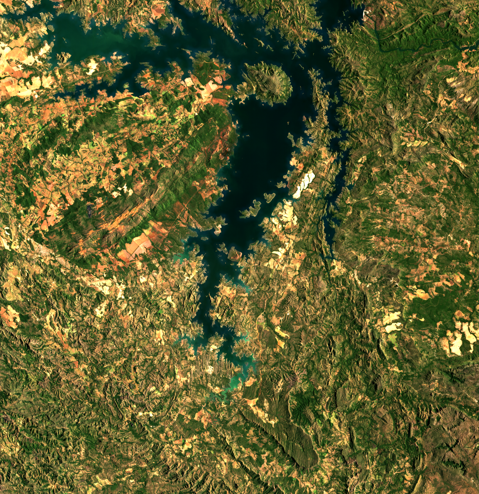
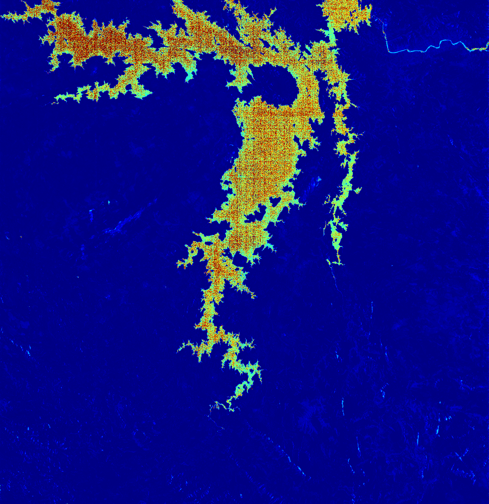
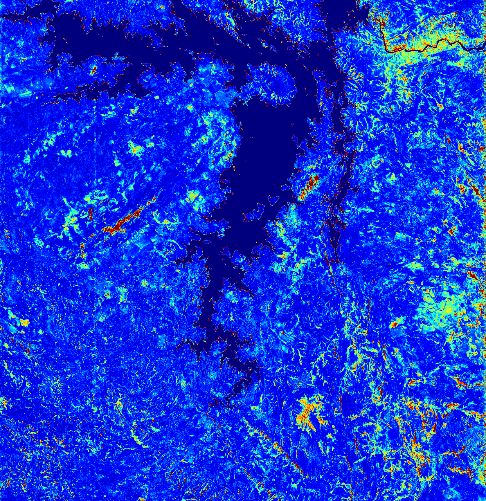
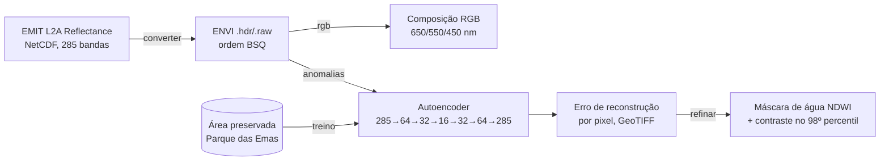

# CodeCraft — Anomalias ambientais em imagens hiperespectrais da NASA

[](https://github.com/huguerra1/codecraft/actions/workflows/ci.yml)

Projeto desenvolvido em equipe num hackathon (outubro de 2025). Ele detecta **anomalias ambientais**,
como áreas de mineração e solo exposto, em imagens do espectrômetro **NASA EMIT**, instalado na
Estação Espacial Internacional. Para isso, usa um **autoencoder** treinado só com a vegetação de uma
área preservada.

> **Ideia central:** o modelo aprende como é o espectro "saudável" do Cerrado no Parque Nacional das
> Emas (GO). Na área analisada, Niquelândia (GO), região de mineração de níquel, os pixels que ele
> **não consegue reconstruir bem** são os que fogem desse padrão: as anomalias.

| Composição RGB (Niquelândia) | Erro de reconstrução | Mapa final (água mascarada) |
|---|---|---|
|  |  |  |

## Como funciona



1. **Conversão:** o produto L2A Reflectance do EMIT (NetCDF) vira ENVI, com as dimensões
   identificadas pelo nome (`bands`, `downtrack`, `crosstrack`) e os comprimentos de onda no cabeçalho.
2. **Treino:** os pixels válidos da área preservada são normalizados (MinMax) e alimentam um
   autoencoder denso com gargalo de 16 neurônios.
3. **Detecção:** na área analisada, o erro quadrático médio entre o espectro original e o
   reconstruído é o "grau de anomalia" de cada pixel. O GeoTIFF guarda o erro real, com a
   georreferência da imagem original.
4. **Refinamento:** a água (NDWI > 0,2) é mascarada, porque rios e represas também fogem do padrão da
   vegetação. O contraste é recalculado só sobre a terra, para destacar as anomalias sutis.

## Como rodar

Requer Python 3.10+.

```bash
python -m venv .venv
.venv\Scripts\activate            # Linux/macOS: source .venv/bin/activate
pip install -r requirements.txt
```

### Dados

As cenas não estão no repositório (cerca de 1,8 GB cada). Baixe o produto **EMIT L2A Reflectance
(EMITL2ARFL)** no [NASA Earthdata Search](https://search.earthdata.nasa.gov/), que exige uma conta
gratuita. Pegue uma cena sobre a área preservada e outra sobre a área a analisar, e salve as duas em
`dados/`.

### Pipeline

```bash
python -m codecraft converter dados/emas.nc saida/emas
python -m codecraft converter dados/niquelandia.nc saida/niquelandia
python -m codecraft rgb saida/niquelandia.hdr saida/niquelandia_rgb.png
python -m codecraft anomalias saida/emas.hdr saida/niquelandia.hdr saida/anomalias.tif saida/anomalias.png --epocas 50 --semente 42
python -m codecraft refinar saida/niquelandia.hdr saida/anomalias.tif saida/anomalias_refinado.png
```

Use `python -m codecraft <comando> --help` para ver as opções. O TensorFlow só é carregado no comando
`anomalias`.

### Testes

```bash
python -m unittest discover -s tests -v
```

Os testes usam dados sintéticos pequenos: escolha de bandas, máscara de pixels válidos, normalização
por percentil, NDWI, cabeçalho ENVI, conversão de um NetCDF sintético e ajuda da CLI. O teste de ponta
a ponta do treino e da detecção usa dois cubos ENVI de 12×12 pixels e 20 bandas, com três épocas e
semente fixa, e verifica os mapas gerados e o erro maior na região anômala. Esse teste roda somente
onde o TensorFlow estiver instalado; sem ele, é pulado automaticamente (inclusive no CI).

## Estrutura

```text
codecraft/
  conversao.py      NetCDF EMIT → ENVI
  rgb.py            composição RGB com realce de contraste
  anomalias.py      autoencoder e mapa de erro de reconstrução
  refinamento.py    máscara de água (NDWI) e contraste final
  processamento.py  funções puras usadas pelos módulos acima
  __main__.py       linha de comando
tests/              testes com unittest
docs/img/           resultados do hackathon
```

## Limitações e próximos passos

- O "grau de anomalia" é relativo à área de treino: vegetação diferente do Cerrado preservado (por
  exemplo, agricultura) também aparece como anomalia.
- Não há rótulos de verdade de campo; a validação foi visual, comparando com a composição RGB e com
  áreas de mineração conhecidas.
- Ideias: métricas com polígonos de mineração conhecidos (MapBiomas), comparação com Isolation Forest
  e PCA, e mapas de abundância mineral a partir das bandas SWIR.

## Equipe

Projeto desenvolvido em equipe no hackathon. <!-- TODO: adicionar os nomes e o nome do evento. -->
